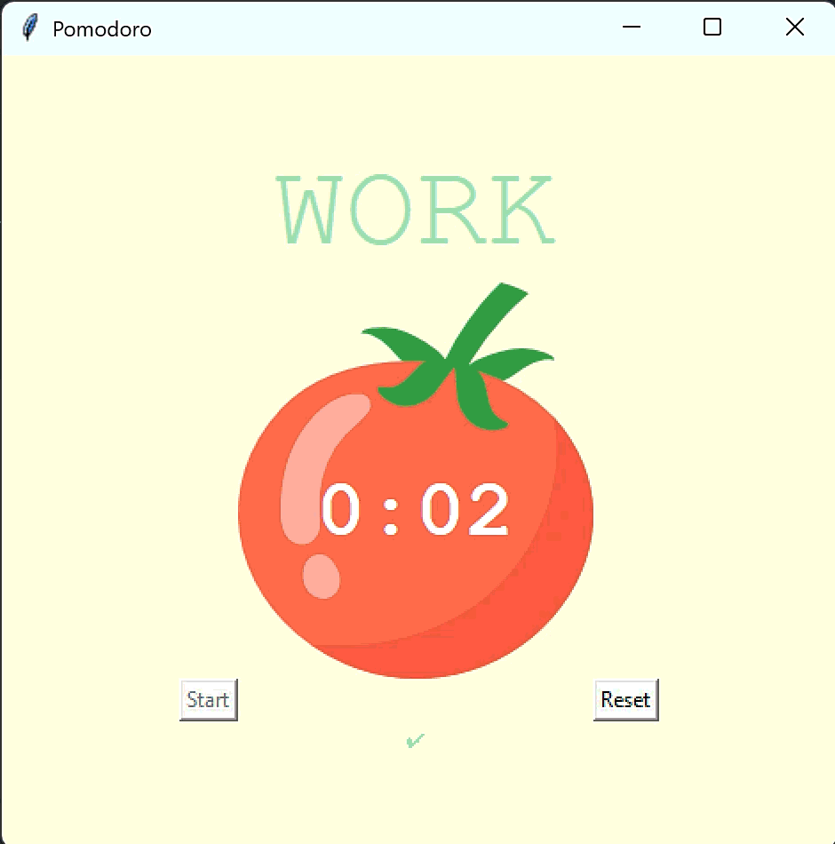
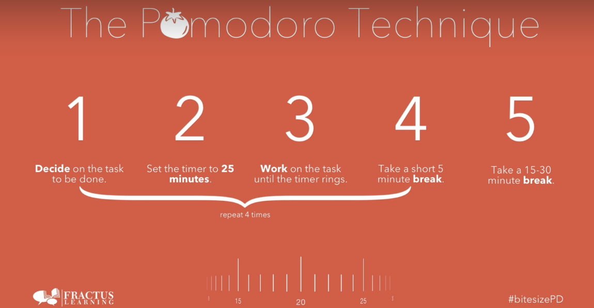

# Day 28 - Tkinter, Dynamic Typing and the Pomodoro GUI Application
___
## Concepts Practised
___
- How to work with the Canvas Widget and Add Images to Tkinter
- Add a Count Down Mechanism
- Dynamic Typing
- Setting Different Timer Sessions and Values
- Adding Checkmarks and Resetting the Application
- Using states to disable 'START' button functionality upon activation

## Pomodoro Timer

___

## Python is a Strongly Typed Language, Dynamic Typing
https://stackoverflow.com/questions/11328920/is-python-strongly-typed

### Misc.
___
https://colorhunt.co/
